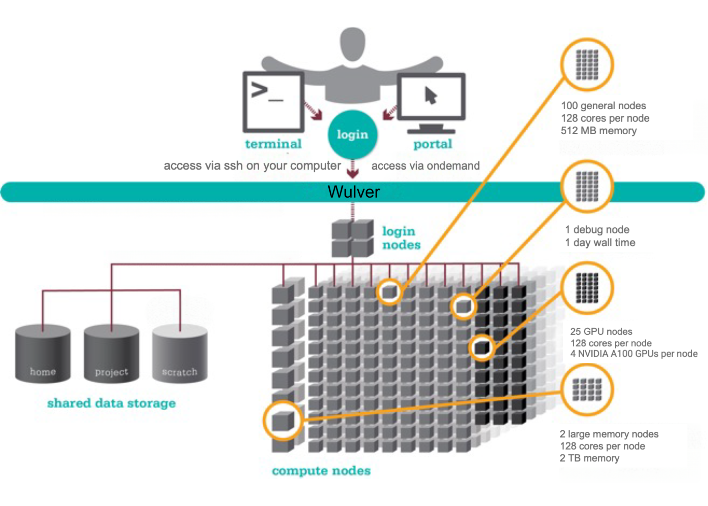

# Getting Started on Wulver
[Wulver](wulver.md) is a high performance computing (HPC) cluster – a collection of computers and data storage connected with high-speed low-latency networks. We refer to individual computers in this network as nodes. Wulver is only accessible to researchers remotely; your gateways to the cluster are the **login nodes**. From these nodes, you can view and edit files and dispatch jobs to computers configured for computation, called **compute nodes**. The tool we use to manage these jobs is called a **job scheduler**. All compute nodes on a cluster mount several shared **filesystems**; a file server or set of servers store files on a large array of disks. This allows your jobs to access and edit your data from any compute node. 

{ width=50% height=50%}

## Being a Good HPC Citizen
While using HPC resources, here are some important things to remember:

* Do not run jobs or computation on a login node, instead submit jobs to compute nodes.  You should be using `sbatch`, `srun`, or OnDemand to run your jobs.  
* Never give your password to anyone else.
* Do not run larger numbers of very short (less than a minute) jobs
Use of the clusters is also governed by our official guidelines. Violating the guidelines might result in having your access to Wulver revoked, but more often the result is your jobs will run painfully slower.

## Request an Account
Every Wulver account is sponsored by an NJIT faculty member. Faculty and PIs request accounts for their group members by emailing [hpc@njit.edu](mailto:hpc@njit.edu) with each person's UCID; students should copy their advisor on the request. Course instructors and sponsors of guest accounts use a request form instead. See [Requesting an Account on Wulver](account_request.md) for what to include and what happens next.

## Remote Access
All users access the Wulver cluster remotely, either through ssh or a browser using the Open OnDemand portal. See these detailed [login instructions](cluster_access.md). NB: If you want to access the clusters from outside NJIT’s network, you must use the VPN.

## Schedule a Job
On our cluster, you control your jobs using a job scheduling system called **Slurm** that allocates and manages compute resources for you. You can submit your jobs in one of two ways. For testing and small jobs, you may want to run a job interactively. This way you can directly interact with the compute node(s) in real time. The other way, which is the preferred way for multiple jobs or long-running jobs, involves writing your job commands in a script and submitting that to the job scheduler. Please see our [Running Jobs](../Running_jobs/index.md) or review our [training materials](../HPC_Events_and_Workshops/index.md) for more details.  

## Use Software
To best serve the diverse needs of all our researchers, we use software modules to make multiple versions of popular software available. **Modules** allow you to swap between different applications and versions of those applications. The software can be loaded via `module load` command. You see the following modules are loaded once you log in to the Wulver. Use the `module li` command to see the modules. 
```bash
   1) easybuild   2) slurm/wulver   3) null
```
If you cannot find certain software or libraries on the Wulver cluster, please submit a request for [HPC Software Installation](https://njit.service-now.com/sp?id=sc_cat_item&sys_id=0746c1f31b6691d04c82cddf034bcbe2&sysparm_category=405f99b41b5b1d507241400abc4bcb6b) by visiting the [Service Catalog](https://njit.service-now.com/sp?id=sc_category). The list of installed software or packages on the Wulver HPC cluster can be found in the [Software List](../Software/index.md#software-list).

## Shared Filesystems
A critical component of Wulver is its shared filesystem, which facilitates the efficient storage, retrieval, and sharing of data among the various compute nodes. It enables multiple users and applications to read from and write to a common storage pool, ensuring data consistency and accessibility across the entire system.
See [Wulver Filesystems](Wulver_filesystems.md) for a different type of shared filesystems.

## Transfer Your Files
As part of setting up and running jobs and collecting results, you will want to copy files between your computer and the clusters. We have a few options, and the best for each situation usually depends on the size and number of files you would like to transfer. For most situations, uploading a small number of smaller files through Open OnDemand's upload interface is the best option. This can be done directly through the file viewer interface by clicking the <kbd>Upload</kbd> button and dragging and dropping your files into the upload window. Check the [Ondemand file transfer](../OnDemand/index.md#files) for more details. For more information on other upload methods, see our [transferring data instructions](cluster_access.md#transfer-your-files). 

## Workshop and Training Videos
Each semester, we host webinars and training sessions. Please check the list of events and register from [HPC Events](../HPC_Events_and_Workshops/index.md). You can also check the recordings of previously hosted webinars at [HPC Training](../HPC_Events_and_Workshops/Workshop_and_Training_Videos/index.md).

## Linux
Our cluster runs Red Hat Enterprise Linux 8, utilizing the bash (or zsh set via https://myucid.njit.edu) command line interface (CLI).  A basic familiarity with Linux commands is required for interacting with the clusters. We have a list of commonly used commands here. We periodically run an Intro to Linux Training to get you started, see our Events for upcoming training. There are also many excellent beginner tutorials available for free online, including the following:

* [Unix Tutorial for Beginners](https://info-ee.surrey.ac.uk/Teaching/Unix/index.html)
* [Cornell Virtual Workshop: An Introduction to Linux](https://cvw.cac.cornell.edu/Linux/)

In the table below, you can find the basic linux commands required to use the cluster. For more details on linux commands, please see the [Linux commands cheat sheets](https://www.linuxtrainingacademy.com/linux-commands-cheat-sheet).

```python exec="on"
import pandas as pd

df = pd.read_csv('docs/assets/tables/commands.csv')
print(df.to_markdown(index=False))
```

## Get Help
If you have additional questions, please email us at hpc@njit.edu. If you are having a problem with `sbatch` or `srun`, please include the following information:

* Job ID#(s)
* Error messages
* Command used to submit the job(s)
* Path(s) to scripts called by the submission command
* Path(s) to output files from your jobs

Here are some tips to get help faster:

* The fastest way to get help is by sending an email to HPC@NJIT.EDU, this is routed right to us at [ARCS HPC](../about/index.md) and will be answered by the most knowledgeable team member based on your question.
* Never reply to an earlier HPC email incident as the ticketing system does not make a new ticket when you respond to an already closed ticket.

